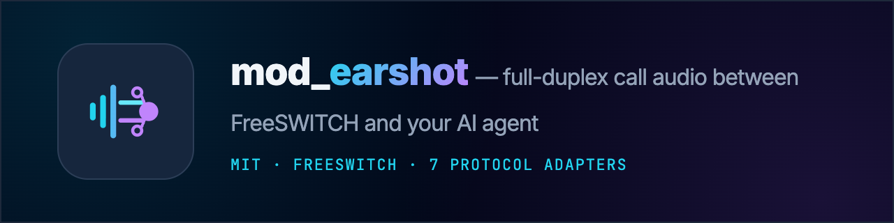
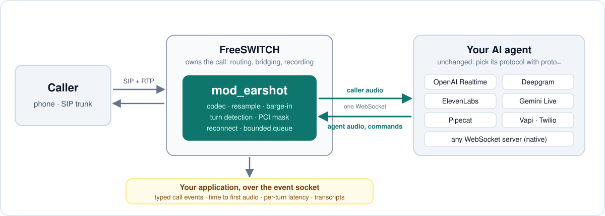
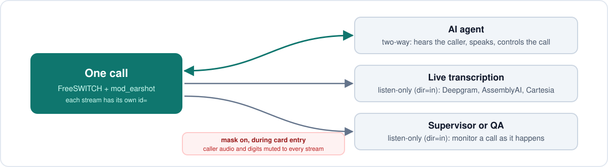

<p align="center">
  
</p>

<p align="center">
  <a href="https://github.com/wiringai/mod_earshot/releases/latest"></a>
  <a href="https://github.com/wiringai/mod_earshot/actions/workflows/ci.yml"></a>
  <a href="LICENSE"></a>
  
  
</p>

# Earshot — `mod_earshot`

> A FreeSWITCH module that streams live call audio to your AI agent over a WebSocket —
> and plays the agent's voice back — full duplex, with ten ready-made protocol adapters,
> module-side VAD endpointing, agent-driven call control, PCI masking, multi-stream fan-out,
> and built-in latency metrics.

<p align="center">
  <a href="FEATURES.md"><b>Features</b></a> &nbsp;·&nbsp;
  <a href="WHY.md">Why</a> &nbsp;·&nbsp;
  <a href="QUICKSTART.md">Quickstart</a> &nbsp;·&nbsp;
  <a href="docs/API.md">API</a> &nbsp;·&nbsp;
  <a href="docs/ARCHITECTURE.md">Architecture</a> &nbsp;·&nbsp;
  <a href="ROADMAP.md">Roadmap</a> &nbsp;·&nbsp;
  <a href="SECURITY.md">Security</a> &nbsp;·&nbsp;
  <a href="CONTRIBUTING.md">Contributing</a>
</p>

---

## How it works

<p align="center">
  
</p>

FreeSWITCH keeps the call: routing, transfers, recording, conferencing. Earshot adds one thing to
it, a two-way audio stream between that call and an AI agent, in whichever protocol the agent
already speaks. Nothing changes in the agent, and nothing between the caller and FreeSWITCH.

**Install a release** (Debian 12, FreeSWITCH 1.10 or 1.11; other systems build from source below):

```bash
# pick the file for your FreeSWITCH from https://github.com/wiringai/mod_earshot/releases/latest
sudo dpkg -i mod-earshot_*_fs1.11_debian12_amd64.deb
fs_cli -x "load mod_earshot"
```

---

## Why Earshot

Every FreeSWITCH voice-AI write-up hits the same wall: the open-source edition of the incumbent
module (`mod_audio_stream`) sends caller audio out but has no dependable **playback** (agent → caller),
forcing `uuid_broadcast` hacks. Its newer releases add playback in a closed build that is free up to
10 concurrent channels. Earshot is an MIT-licensed **`mod_audio_stream` alternative** with no channel
limit, whose `WRITE_REPLACE` path is validated with real audio, full duplex, on one leg. That's the wedge — everything else builds on it. The full pitch is in
**[WHY.md](WHY.md)**; the complete capability list is in **[FEATURES.md](FEATURES.md)**.

- **10 wire protocols, agent unmodified** — `native`, `twilio`, `openai` (Realtime),
  `deepgram` (Voice Agent), `vapi`, `elevenlabs`, `gemini` (Live), `pipecat`, `assemblyai` + `cartesia`
  (streaming STT). Swap vendors with one word.
- **Turn-taking for any agent** — module-side VAD endpointing → `speech_started`/`speech_stopped`, a
  ready-gate (no "answered into silence"), and speech-triggered barge-in. Off by default; leave it off
  for agents that bring their own VAD (pipecat, Realtime APIs) — see
  **[docs/MODULE-VS-AGENT.md](docs/MODULE-VS-AGENT.md)** for which side should do what.
- **Agent drives the call** — opt-in, per-action control channel (`commands=play,hangup`): transfer,
  hangup, DTMF, play, record, hold, bridge, setvar — with every argument validated (app-exec, path
  traversal, and exec-triggering variables rejected), audited via `earshot::command`.
- **PCI/PII masking** — mute audio + redact DTMF to the agent during card entry.
- **Multi-stream fan-out** — agent + live transcription + supervisor on one call.
- **Latency KPIs** — time-to-first-audio, per-turn response time, WebSocket RTT, measured at the
  edge (what the caller hears), which agent-side metrics cannot see.
- **Codecs + resampling** — G.711 µ-law/a-law + L16, transparent 8k/16k/24k.
- **Built on libwebsockets** — the WebSocket transport rides the mature, high-performance
  [libwebsockets](https://libwebsockets.org) library (not a hand-rolled RFC-6455 client), on a
  shared service-loop pool that scales with sessions, not threads.
- **Reliable + observable** — reconnect w/ jitter, bounded queue, `earshot::metrics` events,
  correlation by SIP Call-ID + channel UUID.
- **Migration path** — `uuid_audio_stream` / `audio_stream` compat runs mod_audio_stream dialplans
  that stream L16 audio without changes. The compat events are not identical; see
  **[FEATURES.md](FEATURES.md)** before relying on them.

---

## Works with your agent

Point `proto=` at your stack — same module, one word different. All adapters are
mock-tested in CI; ✅ marks those also validated end-to-end on a real SIP call (against the live
service, or — for the self-hosted Pipecat wire format — its official protobuf schema).

| Agent / protocol             | `proto=`     | Status               |
|------------------------------|--------------|----------------------|
| OpenAI Realtime              | `openai`     | ✅ live-validated    |
| Deepgram Voice Agent         | `deepgram`   | ✅ live-validated    |
| Native (any WebSocket)       | `native`     | ✅ live-validated    |
| Vapi (WebSocket transport)   | `vapi`       | ✅ live-validated    |
| AssemblyAI (streaming STT)   | `assemblyai` | ✅ live-validated · transcription (`dir=in`) |
| Cartesia (streaming STT)     | `cartesia`   | ✅ live-validated · transcription (`dir=in`) |
| Pipecat                      | `pipecat`    | ✅ validated (protobuf) |
| ElevenLabs Conversational AI | `elevenlabs` | ✅ live-validated    |
| Google Gemini Live           | `gemini`     | ✅ live-validated    |
| Twilio Media Streams         | `twilio`     | adapter ✓ · framing echo-tested |

---

## Observability & AI latency — built for scale

`mod_audio_stream` hands you an audio pipe. In production the first question is **"is the agent fast
enough — on every call, right now?"** Earshot answers it with no agent instrumentation: every stream
emits an `earshot::metrics` event (periodic, on-close, or on-demand JSON) carrying the numbers voice
teams actually optimize:

- **Time-to-first-audio** — call start → the agent's first word. The single "does it feel alive?" number.
- **Per-turn response latency** (avg + max) — caller stops → agent starts; catch a slow model or vendor the moment it drifts.
- **WebSocket RTT** — transport health, sampled via ping/pong.
- **Throughput & backpressure** — tx/rx frames + bytes, play-buffer depth, queue drops, reconnects.

These complement, not replace, your agent framework's own metrics: the agent knows which stage was
slow, the module knows whether the caller felt it — including connect time, queuing in front of the
agent, and dropped frames, none of which exist inside the agent process. The split is spelled out in
[docs/MODULE-VS-AGENT.md](docs/MODULE-VS-AGENT.md).

At one call it's a debugger; at ten thousand it's your **fleet latency scoreboard** — ship the events
to Prometheus/OTel and alert on p95 time-to-first-audio *per vendor*. Every metric is keyed to the
**two-key trace** (SIP Call-ID + channel UUID), so a single call stitches together across FreeSWITCH,
your agent, and your logs. Lifecycle, DTMF, barge-in/turn, and agent-command events flow over the same
FreeSWITCH event socket — the whole call is observable, the agent untouched.

---

## Event socket (ESL) — the whole call, as typed events

Everything Earshot observes is published as **FreeSWITCH custom events**, so an application follows a
call without touching the media path, the agent, or the WebSocket. Nothing extra to run: FreeSWITCH's
**Event Socket Layer (ESL)** is already a live subscriber to the event bus, so any ESL client — `fs_cli`,
Node (`modesl`), Python (`greenswitch`), Go — receives them the instant they fire. Every event is tagged
with the channel `Unique-ID` and the correlation id, so you can act on one specific call.

Earshot fires **nine typed events** (subclass `earshot::…`):

| Event | Fires when | Key headers |
|---|---|---|
| `earshot::connected` | WebSocket handshake to the agent completes | `url` |
| `earshot::ready` | playback gate opens — the caller won't answer into silence | `corr` |
| `earshot::speech_started` / `…stopped` | module-side VAD marks a caller turn boundary | `corr` |
| `earshot::dtmf` | caller pressed a digit (redacted inside a PCI mask window) | `digit` \| `masked` |
| `earshot::command` | the agent ran a whitelisted call-control action (audit trail) | `action`, `api`, `ok`, `result` |
| `earshot::metrics` | periodic / on-close / on-demand | latency KPIs + counters |
| `earshot::disconnected` / `…error` | the agent socket closed / failed | `reason` |

Subscribe from `fs_cli` (any ESL client uses the same wire command):

```
event plain CUSTOM earshot::metrics
```

A live `earshot::metrics` frame — exactly the headers your app reads:

```
Event-Subclass:  earshot::metrics
corr:            4a9b8c…@carrier     # = SIP Call-ID — the key that joins your logs
stream-id:       default
first-audio-ms:  62                   # call answered → agent's first word
response-ms:     340                  # last caller-stop → agent-start, per turn
response-ms-max: 610
ws-rtt-ms:       1                    # transport health, sampled via ping/pong
```

**What you build with it** — no agent instrumentation, no polling:

- a live **"caller is speaking"** UI or barge-in indicator (`speech_started` / `speech_stopped`),
- a per-call **latency scoreboard / p95 alert** (`metrics` → Prometheus/OTel),
- a **compliance audit log** of every agent-driven action (`command`) and DTMF (`dtmf`),
- call routing / hand-off logic gated on `ready`, `disconnected`, or `error`.

Because every event carries the **two-key trace** (SIP `Call-ID` ↔ channel `UUID`), one call stitches
together across your load balancer, FreeSWITCH, the agent, and your logs — you write no correlation
plumbing. That's the step up from a raw audio pipe: where `mod_audio_stream` relays the agent's
messages as one generic event, Earshot emits a **typed call lifecycle** an application can act on directly.

---

## 60-second quickstart

**1. Build & install** (needs FreeSWITCH dev headers + `libwebsockets-dev`):

```bash
cmake -S . -B build && cmake --build build
sudo cmake --install build        # -> /usr/lib/freeswitch/mod/mod_earshot.so
fs_cli -x "load mod_earshot"
```

**2. Point a call at your agent** — dialplan:

```xml
<extension name="ai-agent">
  <condition field="destination_number" expression="^5000$">
    <action application="answer"/>
    <action application="earshot" data="start ws://127.0.0.1:9099/ws proto=native vad=on vad_barge=on"/>
    <action application="playback" data="silence_stream://-1"/>   <!-- keep the leg up -->
  </condition>
</extension>
```

**3. Any WebSocket agent works.** A minimal echo agent (hear yourself talk):

```python
# pip install websockets
import asyncio, websockets
async def handle(ws):
    async for msg in ws:            # binary caller audio (µ-law 8k by default)
        await ws.send(msg)          # ...echo it straight back to the caller
async def main():
    async with websockets.serve(handle, "0.0.0.0", 9099):
        await asyncio.Future()
asyncio.run(main())
```

Call `5000` and you'll hear yourself — proving both directions. Swap the echo for your LLM,
or point `proto=` at OpenAI/Deepgram/ElevenLabs/Gemini/Pipecat and run your existing agent unchanged.
More recipes (pipecat, OpenAI Realtime, transcription fan-out, PCI masking) in **[QUICKSTART.md](QUICKSTART.md)**.

---

## The command surface

Dialplan **app** (operates on the current channel):

```xml
<action application="earshot" data="start ws://agent/ws proto=openai commands=true metrics=10"/>
```

**API** (fs_cli / ESL — `<uuid>` first, then the verb):

```
earshot <uuid> start ws://agent/ws proto=native [id=<name>] [dir=in|out|both] ...
earshot <uuid> flush                 # barge-in: clear queued agent audio
earshot <uuid> send  '{"type":"..."}'
earshot <uuid> mask  on|off          # PCI: mute audio + redact DTMF to the agent
earshot <uuid> status | metrics      # per-stream JSON (add id=<name> for a fan-out fork)
earshot <uuid> stop
```

Fan-out — many streams on one channel:

<p align="center">
  
</p>

```xml
<action application="earshot" data="start ws://agent/ws"/>
<action application="earshot" data="start ws://stt/ws id=transcribe dir=in proto=deepgram"/>
<action application="earshot" data="start ws://mon/ws id=supervisor dir=in"/>
```

Full option/verb/event reference: **[FEATURES.md](FEATURES.md)** · API detail: **[docs/API.md](docs/API.md)** ·
internals: **[docs/ARCHITECTURE.md](docs/ARCHITECTURE.md)**.

---

## Build, package, test

```bash
cmake -S . -B build && cmake --build build   # module (needs FS headers) + unit tests
ctest --test-dir build                       # codec / queue / protobuf unit tests (no FS needed)
cpack --config build/CPackConfig.cmake -G DEB   # -> mod-earshot_*.deb  (when FS headers are present)
docker build -t earshot-build .              # reproducible build image (see Dockerfile)
```

The portable core (codec, protobuf) unit-tests without FreeSWITCH, so CI stays
green on any runner; the module itself compiles where FS dev headers are available. See
[`.github/workflows/ci.yml`](.github/workflows/ci.yml).

## Support and services

Earshot is MIT-licensed and free to use at any scale. The maintainers run it in production for
AI voice agents, and can help you do the same:

- **Production install and review** — your FreeSWITCH, your agent, a tested dialplan, load and failure checks.
- **A custom protocol adapter** — for an agent or vendor that is not on the list above.
- **Compliance help** — PCI masking tied to your call flow, mutual TLS, keeping credentials out of events and CDRs.
- **Ongoing support** — a named contact, agreed response times, help with upgrades.

Write to **varunps2003@gmail.com** with what you are building. Bug reports and questions about the
module itself are welcome in [issues](https://github.com/wiringai/mod_earshot/issues), free, as always.

## Naming

`Earshot` / `mod_earshot` is a working name (evokes "within earshot"). It's a single token across the
source and CMake — see the note at the top of `src/mod_earshot.c` to rename.

## License

MIT — see [LICENSE](LICENSE). Attribution and provenance in [NOTICE](NOTICE).
Contributions welcome — [CONTRIBUTING.md](CONTRIBUTING.md).
